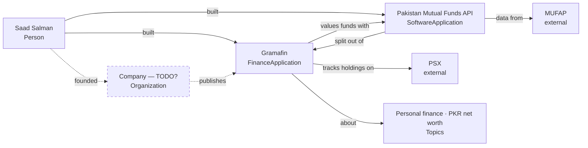

# gramafin.com: entity map (draft, awaiting owner confirmation)

The first `/entity-seo` run had no `entities.yaml`, so it ran **`map`**. The data is in
[`entities.yaml`](entities.yaml). Dashed nodes are unconfirmed.

## What the first pass found

- **The search engine doesn't know Gramafin yet.** A search for "Gramafin" returns
  Gramicidin, Gramcef and Glutafin (drug names), with nothing about the app. The
  only pages that describe it are self-published (saadsalman.org, a dev.to post).
  There's no independent confirmation of it yet.
- **The strongest *why* line:** the Pakistan Mutual Funds API began as Gramafin's
  NAV scraper. It's stated on saadsalman.org but not yet on gramafin.com itself.
- **The brand vs. company question is open.** If no registered company exists,
  Gramafin is a product the Person publishes. Don't invent an Organization.

## Next actions once confirmed
1. `audit`: crawl gramafin.com (titles, JSON-LD, `site:` indexing, word counts).
2. `site`: the `SoftwareApplication` graph on gramafin.com linking to the Person
   `@id`, an `/about` page ("by Saad Salman"), and feature pages (PSX tracker, mutual
   fund NAVs, PKR net worth), plus an `llms.txt` with the disambiguation line.
3. `reinforce`: LinkedIn project entry, GitHub/npm READMEs linking back, and
   app-store listings naming the developer.
