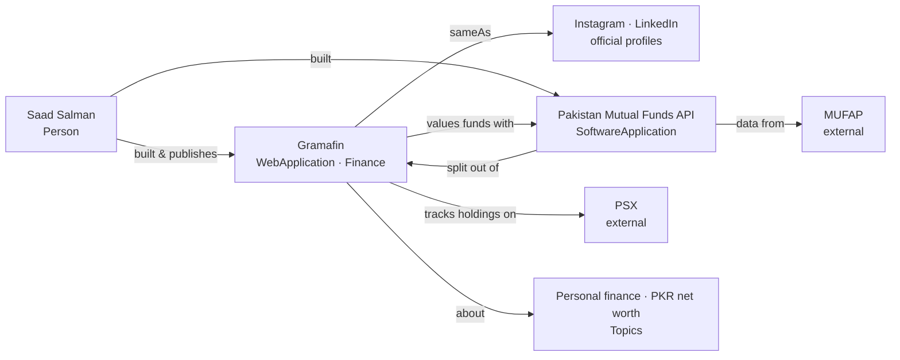

# gramafin.com: entity map (owner answers added; a few TODOs remain)

The first `/entity-seo` run had no `entities.yaml`, so it ran **`map`**. The data is in
[`entities.yaml`](entities.yaml). Dashed nodes are unconfirmed.

## What the first pass found

- **The search engine doesn't know Gramafin yet.** A search for "Gramafin" returns
  Gramicidin, Gramcef and Glutafin (drug names), with nothing about the app. The
  only pages that describe it are self-published (saadsalman.org, a dev.to post).
  There's no independent confirmation of it yet.
- **The strongest *why* line:** the Pakistan Mutual Funds API began as Gramafin's
  NAV scraper. It's stated on saadsalman.org, and the `audit` will check whether
  gramafin.com says it too.
- **There's no company (owner confirmed).** Gramafin is a personal project, so
  Saad Salman is both its creator and its publisher, with no Organization node.
  It's web only, live, with open sign-up.
- **Search doesn't find the social profiles either.** Gramafin's Instagram and
  LinkedIn pages don't show up in search yet. Linking them from the site's
  `sameAs` and footer, and back again, is the cheapest fix.

## Next actions once confirmed
1. `audit`: crawl gramafin.com (titles, JSON-LD, `site:` indexing, word counts).
2. `site`: the `SoftwareApplication` graph on gramafin.com linking to the Person
   `@id`, an `/about` page ("by Saad Salman"), and feature pages (PSX tracker, mutual
   fund NAVs, PKR net worth), plus an `llms.txt` with the disambiguation line.
3. `reinforce`: Instagram and LinkedIn page bios (from `statements.social_bio`),
   with the link back to gramafin.com; a Gramafin project entry on Saad's personal
   LinkedIn; GitHub/npm READMEs for the API linking back to Gramafin.
